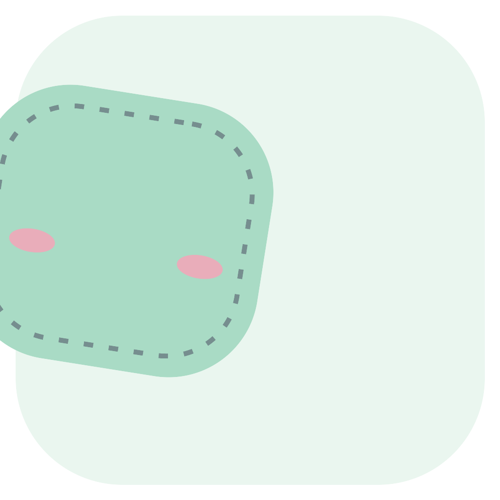
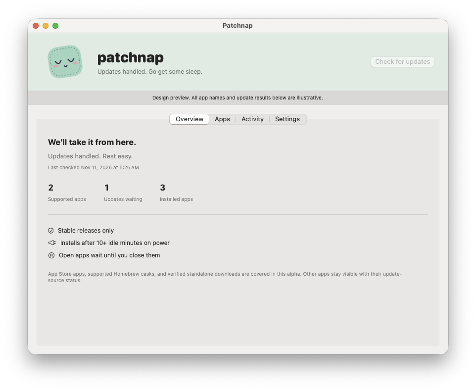

# Patchnap



**Updates handled. Go get some sleep.**

A small, open-source Mac utility that checks for stable app updates and installs eligible ones while your Mac is idle and plugged in. No account, subscription, or telemetry.

> Early alpha. The Apple Silicon download is signed and notarized. Provider coverage is explicit, and live unattended installation acceptance is still in progress. It starts paused; no real user app was upgraded during validation.

[Download the Apple Silicon alpha](https://github.com/kylnor/patchnap/releases) · [Build from source](#build)



## What it does

- Checks on a three-hour cadence and revisits deferred updates every 15 minutes while your Mac is awake.
- Waits for external power and at least ten minutes without keyboard or mouse activity.
- Leaves running apps alone; pauses between installs when you return.
- Supports per-app exclusions, holding an installed version, bounded retries, and a local history.
- Filters the app list by source and status, combined with search, with a matching count and clear action.
- Reads the resulting app version and developer signature after installation before calling an update complete.
- Shows unsupported apps and provider failures instead of claiming everything is current.

## Coverage

| Source | First-release behavior |
| --- | --- |
| Mac App Store | Discover with `mas`; install through an optional, narrowly scoped administrator-approved helper. Requires an Apple Account already signed in to the App Store. |
| Homebrew | Installed, stable, official casks with one app artifact, a comparable installed version, and no installer, dependencies or service-removal actions. Existing command wrappers are retained. Runs as your user. |
| Standalone apps | Match a maintained public Homebrew catalog entry; verified HTTPS checksum, same signed developer and bundle ID, compatible architecture/macOS, Gatekeeper acceptance, staged replacement and rollback on failed verification. ZIP/DMG app bundles only; no installer scripts. |
| Other apps | Listed as unsupported. Dedicated Sparkle integration and installer packages are not implemented. |
| macOS, Safari, Homebrew formulae, firmware | Outside this release's scope. |

An app being installed on your Mac does not mean Homebrew manages it. Patchnap never silently adopts a standalone app into Homebrew or overwrites an App Store receipt with a standalone build. Catalog updates replace only the same signed app, without executing a Homebrew recipe. A sleeping or powered-off Mac cannot run maintenance; Patchnap catches up after the Mac is awake and idle.

## Build

Requires macOS 14+, Xcode Command Line Tools with Swift 6+, and optional Homebrew for cask updates. The development build starts paused.

```sh
git clone https://github.com/kylnor/patchnap.git
cd patchnap
swift test
scripts/build-app.sh
open dist/Patchnap.app
```

To bundle App Store support, install `mas` yourself first (`brew install mas`). The build locates its Mach-O binary under the Homebrew prefix; it never runs a downloaded shell installer. Source builds without mas still support Homebrew. A signed build is required to enable the privileged App Store helper.

```sh
PATCHNAP_SIGN_IDENTITY='Developer ID Application: Your Name (TEAMID1234)' \
PATCHNAP_TEAM_ID='TEAMID1234' scripts/build-app.sh
```

For a Mac App Store-only build without Homebrew, set `PATCHNAP_MAS_BINARY` to a built mas Mach-O executable and `PATCHNAP_MAS_LICENSE` to the upstream MIT license file. You are responsible for the dependency notices associated with that binary.

## Start quietly

Move Patchnap.app to /Applications, then open it. Enable background updates in Settings. macOS may require approval under Login Items & Extensions. For App Store installations, enable the separate helper and approve its one-time administrator prompt. This grants permission to one fixed helper operation, not to a shell or package manager.

Closing the menu bar interface does not stop the registered background agent. Pause background updates or disable background registration in Settings to stop it. Quit never silently uninstalls a service you enabled.

## Command line

The bundled agent can perform a read-only discovery pass:

```sh
/Applications/Patchnap.app/Contents/MacOS/patchnap-agent --check --json
```

`--check` always disables installation. `--dry-run` also disables installation. With no flags, the agent follows saved settings and system conditions. The first launch is paused.

## Privacy and security

Settings, state, and the last 300 history events stay in `~/Library/Application Support/Patchnap/`. App lists are not sent to a Patchnap server. Update checks contact Apple, Homebrew, and the relevant download hosts. Developer signature verification does not mean a new stable release cannot contain bugs.

The optional App Store helper and its mas copy are root-owned. The helper checks a numeric App Store ID, installed receipt, active user, power, idle time, and running processes. It never accepts an executable path or arbitrary command. See [architecture](docs/architecture.md), [security policy](SECURITY.md), and [acceptance evidence](docs/acceptance.md).

To uninstall, first disable background maintenance in Patchnap Settings. Remove the App Store helper using its Settings action before deleting the app. Local history may be removed separately.

## Contribute

Read [AGENTS.md](AGENTS.md) and [CONTRIBUTING.md](CONTRIBUTING.md). Provider additions need fixtures demonstrating discovery, stable-channel handling, open-app deferral, installation, and independent version verification. Never use your real installed apps as automated test fixtures.

MIT licensed. Third-party licenses remain with their owners; see [notices](THIRD_PARTY_NOTICES.md).
